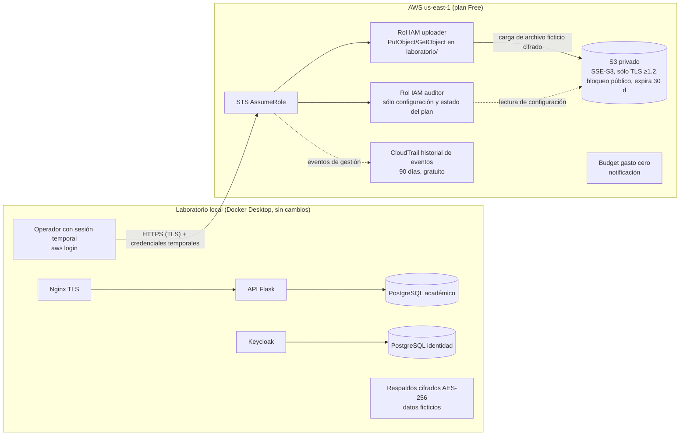

# Arquitectura híbrida mínima AWS — SGSI UVCG

Estado: **diseñada y validada estáticamente; NO desplegada** (no hubo sesión AWS para verificar el plan Free).

## Diagrama (Mermaid, derivado de `aws/main.tf` y sus módulos)

La conexión es **por Internet con TLS e identidad temporal**: **no** es una VPN híbrida privada ni conecta las redes Docker con AWS. Ningún servicio Docker se expone.

## Inventario de recursos (proyectado por el plan)

| Recurso Terraform | Tipo | Estado | Costo |
|---|---|---|---|
| `module.storage.aws_s3_bucket.lab` | Bucket S3 | Preparado | Créditos (fracciones de centavo) |
| `module.storage.aws_s3_bucket_public_access_block.lab` | Configuración | Preparado | 0 |
| `module.storage.aws_s3_bucket_ownership_controls.lab` | Configuración | Preparado | 0 |
| `module.storage.aws_s3_bucket_server_side_encryption_configuration.lab` | SSE-S3 | Preparado | 0 |
| `module.storage.aws_s3_bucket_lifecycle_configuration.lab` | Expiración de 30 días | Preparado | 0 |
| `module.storage.aws_s3_bucket_policy.lab` | Política (TLS, escritura restringida) | Preparado | 0 |
| `module.iam.aws_iam_role.uploader` / `aws_iam_role_policy.uploader` | IAM | Preparado | 0 |
| `module.iam.aws_iam_role.auditor` / `aws_iam_role_policy.auditor` | IAM | Preparado | 0 |
| `module.guardrails.aws_budgets_budget.zero_spend` | Budget | Preparado | 0 |

Total: 11 recursos (6 de S3, 4 de IAM y 1 presupuesto); la compuerta del plan admite como máximo 12 y sólo de estos tipos.

## Componentes diseñados pero excluidos (sólo documentados)

VPN Site-to-Site o Client VPN, NAT Gateway, EC2 (bastión o agente), RDS, ALB/WAF, KMS CMK, trail con S3, GuardDuty, Security Hub y AWS Organizations/SCP: tienen costo no garantizado como cero o fuerzan el paso a Paid. La arquitectura híbrida completa de referencia está en `CIERRE_AZURE.md`.
