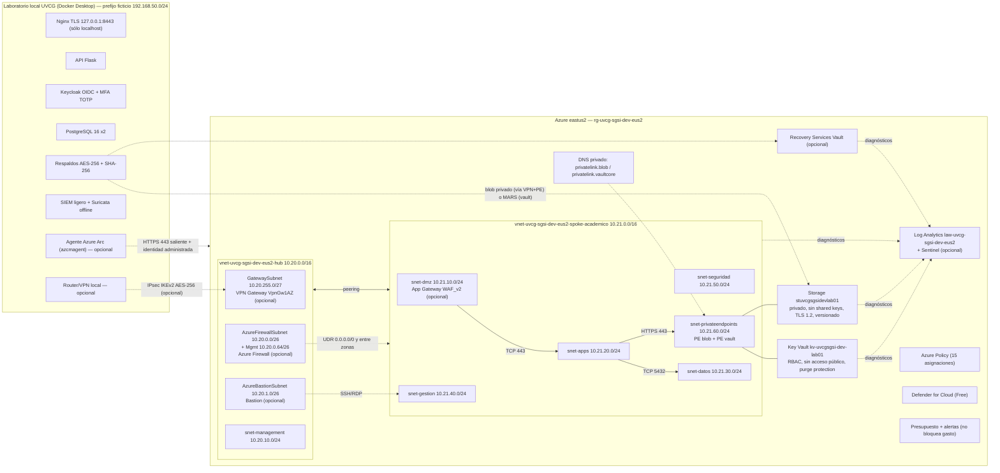

# Arquitectura Azure del SGSI UVCG — PREPARADA, NO DESPLEGADA

Fecha: 2026-10-24. Alcance: universidad ficticia UVCG (3,000 estudiantes, 180 docentes, 120 administrativos).
Estado de **todos** los recursos descritos: **PREPARADO / no desplegado** (no existe suscripción, `apply` no se ha ejecutado).

## 1. Decisión de región

| Criterio | eastus2 (Virginia) | southcentralus (Texas) | Evidencia |
|---|---|---|---|
| Precio (703 medidores comunes comparados) | Menor en 183, igual en 494 | Menor en 26 | `comparacion-regiones-20261024.txt` |
| Sentinel pago por uso (USD/GB) | 4.76 | 5.16 | idem |
| App Gateway WAF_v2 fijo (USD/h) | 0.36 | 0.432 | idem |
| Escenario 3 institucional (USD/mes) | 2,962.96 | 3,076.32 | `costos-escenarios-20261024*.md` |
| Escenarios 1 y 2 (USD/mes) | 16.90 / 73.88 | 16.90 / 73.88 | idem |
| Disponibilidad de los servicios usados | Medidores publicados para todos los servicios del diseño | Igual | `precios-azure-20261024.json` |
| Latencia desde Guatemala | Mayor distancia geográfica | Menor distancia geográfica | **No medida** (requiere prueba real, p. ej. sondeo HTTPS a un recurso de prueba en cada región) |

**Decisión: `eastus2`** (precio igual o menor en el 96 % de los medidores comparados y menor en Sentinel/WAF, que dominan el
escenario institucional). `southcentralus` queda como alternativa permitida por la validación de la variable `location`
(si la medición de latencia lo justificara). La publicación de medidores de precio demuestra disponibilidad comercial del
servicio en la región, **no** cuota ni capacidad disponible para una suscripción concreta (se verifica en el plan de despliegue).
No existe región de Azure en Guatemala; ambas opciones implican residencia de datos en EE. UU. (aceptable sólo con datos ficticios, RC-11).

## 2. Estructura del código (`azure/`)

| Ruta | Contenido |
|---|---|
| `versions.tf` / `providers.tf` | Terraform ≥ 1.9; AzureRM `~> 4.0` (lock 4.81.0, sin actualizar); `storage_use_azuread`, sin plano de datos de Storage, registro acotado de proveedores |
| `backend.tf` | Backend `azurerm` **comentado** (Storage con Entra ID, sin claves, versionado); sin estado en el repositorio |
| `variables.tf` / `locals.tf` / `outputs.tf` | Región restringida (`eastus2`, `southcentralus`), nombres `<prefijo>-<ambiente>-<región>`, etiquetas obligatorias, 11 banderas de costo en `false` |
| `environments/*.tfvars.example` | `dev` = Escenario 1, `demo` = Escenario 2, `inst` = Escenario 3 (referencia), `backend-dev.hcl.example` |
| `modules/networking` | Hub y spoke, peering, 11 subredes, 7 NSG, reglas explícitas + denegación 4096, UDR al firewall, DNS privado, diagnósticos de NSG |
| `modules/security` | Key Vault (RBAC, privado, purge protection) + PE; Azure Firewall Basic/Standard + política; Bastion; App Gateway WAF_v2; Defender for Cloud |
| `modules/identity` | 2–3 identidades administradas, RBAC por contenedor/vault/workspace, separación de funciones por grupos |
| `modules/monitoring` | Log Analytics (retención ≥ 30 d, tope diario), registro de actividad, Sentinel opcional, grupo de acciones, 8 alertas del registro de actividad, alerta de consulta, presupuesto |
| `modules/storage` | Cuenta StorageV2 privada, contenedores `evidencias-sgsi` e `intercambio-hibrido`, ciclo de vida, PE blob, diagnóstico |
| `modules/backup` | Recovery Services Vault (inmutabilidad, alertas) y política diaria |
| `modules/hybrid-connectivity` | VPN S2S IKEv2 (opcional) y rol de incorporación a Azure Arc |
| `modules/policies` | 15 asignaciones de definiciones integradas verificadas |
| `tests/escenarios.tftest.hcl` | 5 pruebas con `mock_provider` (plan simulado sin credenciales) |
| `scripts/` | Validación, precios, costos, inventario/diagramas, plan real y revisión de plan |

## 3. Topología

Diagrama generado por `azure/scripts/generar_inventario_diagrama.py` con los CIDR y nombres que **calcula el código**
(`terraform console`, ambiente `dev`). Las líneas discontinuas son componentes opcionales (apagados por defecto).



### Segmentación y flujos permitidos (NSG; el firewall replica las mismas reglas cuando se habilita)

| Zona | CIDR | Entrada permitida | Salida | Notas |
|---|---|---|---|---|
| dmz | 10.21.10.0/24 | Sólo con App Gateway: Internet→443, GatewayManager 65200-65535, AzureLoadBalancer | — | Sin App Gateway: todo denegado |
| apps | 10.21.20.0/24 | dmz → TCP 443 | Vía firewall (FQDN autorizados) | |
| datos | 10.21.30.0/24 | apps → TCP 5432 | Internet **denegado** (4000) | |
| gestion | 10.21.40.0/24 | AzureBastionSubnet → 22/3389 (sólo Bastion Basic/Standard) | Vía firewall | |
| seguridad | 10.21.50.0/24 | Ninguna | Vía firewall | Reservada a herramientas de seguridad |
| privateendpoints | 10.21.60.0/24 | apps, gestion, seguridad y on-premises → 443 | Internet **denegado** | Políticas de red de PE habilitadas |
| Todas | — | **Deny * prioridad 4096** | — | `default_outbound_access_enabled = false` |

Con `enable_firewall = true` cada zona recibe una tabla de rutas: rutas a las demás zonas y a on-premises con siguiente
salto el firewall, y `0.0.0.0/0` al firewall (excepto la DMZ, porque App Gateway v2 no admite ruta por defecto a un
dispositivo virtual). `GatewaySubnet` envía el tráfico de la VPN hacia el spoke a través del firewall.

## 4. Grafo de dependencias real (`terraform graph`)

Generado desde `terraform graph` (70 nodos, 102 aristas). Rojo = recurso con cargo potencial.
Archivo fuente: `diagrama-dependencias.mmd`.

```mermaid
%% Generado desde `terraform graph` (recursos reales del código). Flecha: A --> B = A depende de B.
flowchart LR
    data_azurerm_client_config_current["data.azurerm_client_config.current"]
    data_azurerm_subscription_current["data.azurerm_subscription.current"]
    azurerm_resource_group_lab["azurerm_resource_group.lab"]
  subgraph backup["module.backup"]
    module_backup_azurerm_backup_policy_vm_diaria["azurerm_backup_policy_vm.diaria"]
    module_backup_azurerm_monitor_diagnostic_setting_vault["azurerm_monitor_diagnostic_setting.vault"]
    module_backup_azurerm_recovery_services_vault_this["azurerm_recovery_services_vault.this"]:::costo
  end
  subgraph hybrid_connectivity["module.hybrid_connectivity"]
    module_hybrid_connectivity_azurerm_local_network_gateway_onprem["azurerm_local_network_gateway.onprem"]
    module_hybrid_connectivity_azurerm_monitor_diagnostic_setting_vpn["azurerm_monitor_diagnostic_setting.vpn"]
    module_hybrid_connectivity_azurerm_public_ip_vpn["azurerm_public_ip.vpn"]:::costo
    module_hybrid_connectivity_azurerm_role_assignment_arc_onboarding["azurerm_role_assignment.arc_onboarding"]
    module_hybrid_connectivity_azurerm_virtual_network_gateway_this["azurerm_virtual_network_gateway.this"]:::costo
    module_hybrid_connectivity_azurerm_virtual_network_gateway_connection_s2s["azurerm_virtual_network_gateway_connection.s2s"]:::costo
  end
  subgraph identity["module.identity"]
    module_identity_azurerm_role_assignment_additional["azurerm_role_assignment.additional"]
    module_identity_azurerm_role_assignment_app_evidencias_lectura["azurerm_role_assignment.app_evidencias_lectura"]
    module_identity_azurerm_role_assignment_app_gateway_kv["azurerm_role_assignment.app_gateway_kv"]
    module_identity_azurerm_role_assignment_app_kv_secrets["azurerm_role_assignment.app_kv_secrets"]
    module_identity_azurerm_role_assignment_arc_intercambio["azurerm_role_assignment.arc_intercambio"]
    module_identity_azurerm_role_assignment_intercambio_escritura["azurerm_role_assignment.intercambio_escritura"]
    module_identity_azurerm_role_assignment_sod["azurerm_role_assignment.sod"]
    module_identity_azurerm_user_assigned_identity_app["azurerm_user_assigned_identity.app"]
    module_identity_azurerm_user_assigned_identity_app_gateway["azurerm_user_assigned_identity.app_gateway"]
    module_identity_azurerm_user_assigned_identity_intercambio["azurerm_user_assigned_identity.intercambio"]
  end
  subgraph monitoring["module.monitoring"]
    module_monitoring_azurerm_consumption_budget_resource_group_this["azurerm_consumption_budget_resource_group.this"]
    module_monitoring_azurerm_log_analytics_workspace_this["azurerm_log_analytics_workspace.this"]:::costo
    module_monitoring_azurerm_monitor_action_group_this["azurerm_monitor_action_group.this"]
    module_monitoring_azurerm_monitor_activity_log_alert_sensitive["azurerm_monitor_activity_log_alert.sensitive"]
    module_monitoring_azurerm_monitor_activity_log_alert_service_health["azurerm_monitor_activity_log_alert.service_health"]
    module_monitoring_azurerm_monitor_diagnostic_setting_activity_log["azurerm_monitor_diagnostic_setting.activity_log"]
    module_monitoring_azurerm_monitor_scheduled_query_rules_alert_v2_operaciones_fallidas["azurerm_monitor_scheduled_query_rules_alert_v2.operaciones_fallidas"]:::costo
    module_monitoring_azurerm_sentinel_log_analytics_workspace_onboarding_this["azurerm_sentinel_log_analytics_workspace_onboarding.this"]:::costo
  end
  subgraph networking["module.networking"]
    module_networking_azurerm_monitor_diagnostic_setting_nsg["azurerm_monitor_diagnostic_setting.nsg"]
    module_networking_azurerm_network_security_group_hub_management["azurerm_network_security_group.hub_management"]
    module_networking_azurerm_network_security_group_spoke["azurerm_network_security_group.spoke"]
    module_networking_azurerm_network_security_rule_deny_inbound["azurerm_network_security_rule.deny_inbound"]
    module_networking_azurerm_network_security_rule_explicit["azurerm_network_security_rule.explicit"]
    module_networking_azurerm_private_dns_zone_this["azurerm_private_dns_zone.this"]:::costo
    module_networking_azurerm_private_dns_zone_virtual_network_link_this["azurerm_private_dns_zone_virtual_network_link.this"]
    module_networking_azurerm_route_table_gateway["azurerm_route_table.gateway"]
    module_networking_azurerm_route_table_spoke["azurerm_route_table.spoke"]
    module_networking_azurerm_subnet_hub["azurerm_subnet.hub"]
    module_networking_azurerm_subnet_spoke["azurerm_subnet.spoke"]
    module_networking_azurerm_subnet_network_security_group_association_hub_management["azurerm_subnet_network_security_group_association.hub_management"]
    module_networking_azurerm_subnet_network_security_group_association_spoke["azurerm_subnet_network_security_group_association.spoke"]
    module_networking_azurerm_subnet_route_table_association_gateway["azurerm_subnet_route_table_association.gateway"]
    module_networking_azurerm_subnet_route_table_association_spoke["azurerm_subnet_route_table_association.spoke"]
    module_networking_azurerm_virtual_network_hub["azurerm_virtual_network.hub"]
    module_networking_azurerm_virtual_network_spoke["azurerm_virtual_network.spoke"]
    module_networking_azurerm_virtual_network_peering_hub_to_spoke["azurerm_virtual_network_peering.hub_to_spoke"]
    module_networking_azurerm_virtual_network_peering_spoke_to_hub["azurerm_virtual_network_peering.spoke_to_hub"]
  end
  subgraph policies["module.policies"]
    module_policies_azurerm_resource_group_policy_assignment_this["azurerm_resource_group_policy_assignment.this"]
  end
  subgraph security["module.security"]
    module_security_azurerm_application_gateway_this["azurerm_application_gateway.this"]:::costo
    module_security_azurerm_bastion_host_this["azurerm_bastion_host.this"]:::costo
    module_security_azurerm_firewall_this["azurerm_firewall.this"]:::costo
    module_security_azurerm_firewall_policy_this["azurerm_firewall_policy.this"]
    module_security_azurerm_firewall_policy_rule_collection_group_this["azurerm_firewall_policy_rule_collection_group.this"]
    module_security_azurerm_key_vault_this["azurerm_key_vault.this"]:::costo
    module_security_azurerm_monitor_diagnostic_setting_this["azurerm_monitor_diagnostic_setting.this"]
    module_security_azurerm_private_endpoint_key_vault["azurerm_private_endpoint.key_vault"]:::costo
    module_security_azurerm_public_ip_app_gateway["azurerm_public_ip.app_gateway"]:::costo
    module_security_azurerm_public_ip_bastion["azurerm_public_ip.bastion"]:::costo
    module_security_azurerm_public_ip_firewall["azurerm_public_ip.firewall"]:::costo
    module_security_azurerm_public_ip_firewall_management["azurerm_public_ip.firewall_management"]:::costo
    module_security_azurerm_security_center_contact_this["azurerm_security_center_contact.this"]
    module_security_azurerm_security_center_subscription_pricing_this["azurerm_security_center_subscription_pricing.this"]:::costo
    module_security_azurerm_web_application_firewall_policy_this["azurerm_web_application_firewall_policy.this"]
  end
  subgraph storage["module.storage"]
    module_storage_azurerm_monitor_diagnostic_setting_blob["azurerm_monitor_diagnostic_setting.blob"]
    module_storage_azurerm_private_endpoint_blob["azurerm_private_endpoint.blob"]:::costo
    module_storage_azurerm_storage_account_this["azurerm_storage_account.this"]:::costo
    module_storage_azurerm_storage_container_this["azurerm_storage_container.this"]
    module_storage_azurerm_storage_management_policy_this["azurerm_storage_management_policy.this"]
  end
  module_backup_azurerm_backup_policy_vm_diaria --> module_backup_azurerm_recovery_services_vault_this
  module_backup_azurerm_monitor_diagnostic_setting_vault --> module_backup_azurerm_recovery_services_vault_this
  module_backup_azurerm_monitor_diagnostic_setting_vault --> module_monitoring_azurerm_log_analytics_workspace_this
  module_backup_azurerm_recovery_services_vault_this --> azurerm_resource_group_lab
  module_hybrid_connectivity_azurerm_local_network_gateway_onprem --> azurerm_resource_group_lab
  module_hybrid_connectivity_azurerm_monitor_diagnostic_setting_vpn --> module_hybrid_connectivity_azurerm_virtual_network_gateway_this
  module_hybrid_connectivity_azurerm_monitor_diagnostic_setting_vpn --> module_monitoring_azurerm_log_analytics_workspace_this
  module_hybrid_connectivity_azurerm_public_ip_vpn --> azurerm_resource_group_lab
  module_hybrid_connectivity_azurerm_role_assignment_arc_onboarding --> azurerm_resource_group_lab
  module_hybrid_connectivity_azurerm_virtual_network_gateway_this --> module_hybrid_connectivity_azurerm_public_ip_vpn
  module_hybrid_connectivity_azurerm_virtual_network_gateway_this --> module_networking_azurerm_subnet_hub
  module_hybrid_connectivity_azurerm_virtual_network_gateway_connection_s2s --> module_hybrid_connectivity_azurerm_local_network_gateway_onprem
  module_hybrid_connectivity_azurerm_virtual_network_gateway_connection_s2s --> module_hybrid_connectivity_azurerm_virtual_network_gateway_this
  module_identity_azurerm_role_assignment_additional --> azurerm_resource_group_lab
  module_identity_azurerm_role_assignment_app_evidencias_lectura --> module_identity_azurerm_user_assigned_identity_app
  module_identity_azurerm_role_assignment_app_evidencias_lectura --> module_storage_azurerm_storage_container_this
  module_identity_azurerm_role_assignment_app_gateway_kv --> module_identity_azurerm_user_assigned_identity_app_gateway
  module_identity_azurerm_role_assignment_app_gateway_kv --> module_security_azurerm_key_vault_this
  module_identity_azurerm_role_assignment_app_kv_secrets --> module_identity_azurerm_user_assigned_identity_app
  module_identity_azurerm_role_assignment_app_kv_secrets --> module_security_azurerm_key_vault_this
  module_identity_azurerm_role_assignment_arc_intercambio --> module_storage_azurerm_storage_container_this
  module_identity_azurerm_role_assignment_intercambio_escritura --> module_identity_azurerm_user_assigned_identity_intercambio
  module_identity_azurerm_role_assignment_intercambio_escritura --> module_storage_azurerm_storage_container_this
  module_identity_azurerm_role_assignment_sod --> module_backup_azurerm_recovery_services_vault_this
  module_identity_azurerm_role_assignment_sod --> module_monitoring_azurerm_log_analytics_workspace_this
  module_identity_azurerm_role_assignment_sod --> module_security_azurerm_key_vault_this
  module_identity_azurerm_user_assigned_identity_app --> azurerm_resource_group_lab
  module_identity_azurerm_user_assigned_identity_app_gateway --> azurerm_resource_group_lab
  module_identity_azurerm_user_assigned_identity_intercambio --> azurerm_resource_group_lab
  module_monitoring_azurerm_consumption_budget_resource_group_this --> module_monitoring_azurerm_monitor_action_group_this
  module_monitoring_azurerm_log_analytics_workspace_this --> azurerm_resource_group_lab
  module_monitoring_azurerm_monitor_action_group_this --> azurerm_resource_group_lab
  module_monitoring_azurerm_monitor_activity_log_alert_sensitive --> module_monitoring_azurerm_monitor_action_group_this
  module_monitoring_azurerm_monitor_activity_log_alert_service_health --> data_azurerm_subscription_current
  module_monitoring_azurerm_monitor_activity_log_alert_service_health --> module_monitoring_azurerm_monitor_action_group_this
  module_monitoring_azurerm_monitor_diagnostic_setting_activity_log --> data_azurerm_subscription_current
  module_monitoring_azurerm_monitor_diagnostic_setting_activity_log --> module_monitoring_azurerm_log_analytics_workspace_this
  module_monitoring_azurerm_monitor_scheduled_query_rules_alert_v2_operaciones_fallidas --> module_monitoring_azurerm_log_analytics_workspace_this
  module_monitoring_azurerm_monitor_scheduled_query_rules_alert_v2_operaciones_fallidas --> module_monitoring_azurerm_monitor_action_group_this
  module_monitoring_azurerm_sentinel_log_analytics_workspace_onboarding_this --> module_monitoring_azurerm_log_analytics_workspace_this
  module_networking_azurerm_monitor_diagnostic_setting_nsg --> module_monitoring_azurerm_log_analytics_workspace_this
  module_networking_azurerm_monitor_diagnostic_setting_nsg --> module_networking_azurerm_network_security_group_spoke
  module_networking_azurerm_network_security_group_hub_management --> azurerm_resource_group_lab
  module_networking_azurerm_network_security_group_spoke --> azurerm_resource_group_lab
  module_networking_azurerm_network_security_rule_deny_inbound --> module_networking_azurerm_network_security_group_spoke
  module_networking_azurerm_network_security_rule_explicit --> module_networking_azurerm_network_security_group_spoke
  module_networking_azurerm_private_dns_zone_this --> azurerm_resource_group_lab
  module_networking_azurerm_private_dns_zone_virtual_network_link_this --> module_networking_azurerm_private_dns_zone_this
  module_networking_azurerm_private_dns_zone_virtual_network_link_this --> module_networking_azurerm_virtual_network_hub
  module_networking_azurerm_private_dns_zone_virtual_network_link_this --> module_networking_azurerm_virtual_network_spoke
  module_networking_azurerm_route_table_gateway --> module_security_azurerm_firewall_this
  module_networking_azurerm_route_table_spoke --> module_security_azurerm_firewall_this
  module_networking_azurerm_subnet_hub --> module_networking_azurerm_virtual_network_hub
  module_networking_azurerm_subnet_spoke --> module_networking_azurerm_virtual_network_spoke
  module_networking_azurerm_subnet_network_security_group_association_hub_management --> module_networking_azurerm_network_security_group_hub_management
  module_networking_azurerm_subnet_network_security_group_association_hub_management --> module_networking_azurerm_subnet_hub
  module_networking_azurerm_subnet_network_security_group_association_spoke --> module_networking_azurerm_network_security_group_spoke
  module_networking_azurerm_subnet_network_security_group_association_spoke --> module_networking_azurerm_subnet_spoke
  module_networking_azurerm_subnet_route_table_association_gateway --> module_networking_azurerm_route_table_gateway
  module_networking_azurerm_subnet_route_table_association_spoke --> module_networking_azurerm_route_table_spoke
  module_networking_azurerm_subnet_route_table_association_spoke --> module_networking_azurerm_subnet_spoke
  module_networking_azurerm_virtual_network_hub --> azurerm_resource_group_lab
  module_networking_azurerm_virtual_network_spoke --> azurerm_resource_group_lab
  module_networking_azurerm_virtual_network_peering_hub_to_spoke --> module_networking_azurerm_virtual_network_hub
  module_networking_azurerm_virtual_network_peering_hub_to_spoke --> module_networking_azurerm_virtual_network_spoke
  module_networking_azurerm_virtual_network_peering_spoke_to_hub --> module_hybrid_connectivity_azurerm_virtual_network_gateway_this
  module_networking_azurerm_virtual_network_peering_spoke_to_hub --> module_networking_azurerm_virtual_network_peering_hub_to_spoke
  module_policies_azurerm_resource_group_policy_assignment_this --> azurerm_resource_group_lab
  module_security_azurerm_application_gateway_this --> module_identity_azurerm_role_assignment_app_gateway_kv
  module_security_azurerm_application_gateway_this --> module_networking_azurerm_subnet_spoke
  module_security_azurerm_application_gateway_this --> module_security_azurerm_public_ip_app_gateway
  module_security_azurerm_application_gateway_this --> module_security_azurerm_web_application_firewall_policy_this
  module_security_azurerm_bastion_host_this --> module_networking_azurerm_subnet_hub
  module_security_azurerm_bastion_host_this --> module_security_azurerm_public_ip_bastion
  module_security_azurerm_firewall_this --> module_networking_azurerm_subnet_hub
  module_security_azurerm_firewall_this --> module_security_azurerm_firewall_policy_rule_collection_group_this
  module_security_azurerm_firewall_this --> module_security_azurerm_public_ip_firewall
  module_security_azurerm_firewall_this --> module_security_azurerm_public_ip_firewall_management
  module_security_azurerm_firewall_policy_this --> azurerm_resource_group_lab
  module_security_azurerm_firewall_policy_rule_collection_group_this --> module_security_azurerm_firewall_policy_this
  module_security_azurerm_key_vault_this --> data_azurerm_client_config_current
  module_security_azurerm_key_vault_this --> azurerm_resource_group_lab
  module_security_azurerm_monitor_diagnostic_setting_this --> module_monitoring_azurerm_log_analytics_workspace_this
  module_security_azurerm_monitor_diagnostic_setting_this --> module_security_azurerm_application_gateway_this
  module_security_azurerm_monitor_diagnostic_setting_this --> module_security_azurerm_bastion_host_this
  module_security_azurerm_monitor_diagnostic_setting_this --> module_security_azurerm_firewall_this
  module_security_azurerm_private_endpoint_key_vault --> module_networking_azurerm_private_dns_zone_this
  module_security_azurerm_private_endpoint_key_vault --> module_networking_azurerm_subnet_spoke
  module_security_azurerm_private_endpoint_key_vault --> module_security_azurerm_key_vault_this
  module_security_azurerm_public_ip_app_gateway --> azurerm_resource_group_lab
  module_security_azurerm_public_ip_bastion --> azurerm_resource_group_lab
  module_security_azurerm_public_ip_firewall --> azurerm_resource_group_lab
  module_security_azurerm_public_ip_firewall_management --> azurerm_resource_group_lab
  module_security_azurerm_web_application_firewall_policy_this --> azurerm_resource_group_lab
  module_storage_azurerm_monitor_diagnostic_setting_blob --> module_monitoring_azurerm_log_analytics_workspace_this
  module_storage_azurerm_monitor_diagnostic_setting_blob --> module_storage_azurerm_storage_account_this
  module_storage_azurerm_private_endpoint_blob --> module_networking_azurerm_private_dns_zone_this
  module_storage_azurerm_private_endpoint_blob --> module_networking_azurerm_subnet_spoke
  module_storage_azurerm_private_endpoint_blob --> module_storage_azurerm_storage_account_this
  module_storage_azurerm_storage_account_this --> azurerm_resource_group_lab
  module_storage_azurerm_storage_container_this --> module_storage_azurerm_storage_account_this
  module_storage_azurerm_storage_management_policy_this --> module_storage_azurerm_storage_account_this
  classDef costo fill:#fde2e1,stroke:#b42318,color:#000
```

## 5. Seguridad por diseño

- **Identidad**: Key Vault y Storage sólo con Entra ID/RBAC (sin políticas de acceso ni claves compartidas); identidades
  administradas para cargas; roles por grupo con separación de funciones validada por Terraform (seguridad ≠ respaldo ≠ red);
  `Owner`, `Contributor`, `User Access Administrator` y `RBAC Administrator` rechazados en asignaciones adicionales.
- **Red**: sin IP pública salvo en firewall, Bastion, App Gateway y VPN (todos opcionales); Azure Policy deniega IP pública en NIC.
- **Datos**: TLS 1.2 mínimo, HTTPS obligatorio, cifrado de infraestructura (doble), versionado, borrado suave 14 d,
  `allowed_copy_scope = PrivateLink`, ciclo de vida (Cool a 30 d; intercambio caduca a 30 d).
- **Registro**: actividad de la suscripción, NSG, Key Vault (auditoría), blob, vault, firewall, VPN, App Gateway y Bastion → Log Analytics.
- **Gobierno**: 15 asignaciones de Azure Policy en el grupo de recursos (efecto Deny), presupuesto con alertas (no bloquea), etiquetas obligatorias.
- **Costo**: once banderas `enable_*` en `false`; la prueba `valores_por_defecto_sin_costo` lo verifica.

## 6. Limitaciones

- Ningún recurso existe en Azure; no hay capturas del portal ni salida de `terraform plan` real (requiere suscripción).
- El plan simulado usa un proveedor *mock*: no valida nombres globales, cuotas, permisos, compatibilidad de SKU ni políticas reales.
- Acceso Condicional, PIM e Intune no están en Terraform: requieren licencias Entra ID P1/P2/Intune (ver análisis de costos).
- La latencia desde Guatemala no se midió.
